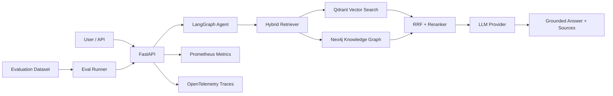

# Hybrid RAG Engine

**Production-shaped LLM retrieval engine combining vector search, a Neo4j knowledge graph, LangGraph orchestration, evaluation, observability, and cloud-ready packaging.**

> Maintained, extended, and benchmarked by **Parth Khiriya** — designed to demonstrate practical LLM engineering: hybrid retrieval, knowledge graphs, agent workflows, model-provider abstraction, evaluation, reliability, and production operations.

## Why this project exists

Pure vector RAG is good at semantic similarity but can miss explicit relationships such as **service → dependency → cluster → owner → incident**. Pure graph retrieval preserves relationships but can miss fuzzy natural-language intent.

This project combines both:

1. **Vector retrieval** for semantic similarity.
2. **Knowledge-graph retrieval** for entities and relationships.
3. **Reciprocal Rank Fusion (RRF)** to merge results.
4. **Reranking** to favor passages that match important query terms/entities.
5. **LangGraph orchestration** for an explicit, testable workflow.
6. **OpenAI / Anthropic adapters** with a local deterministic fallback.
7. **Evaluation + observability** so quality and latency can be measured.

## Architecture



## What it demonstrates

| Capability | Evidence in repo |
|---|---|
| Agentic LLM workflow | LangGraph state machine with retrieval → fusion → generation |
| Hybrid RAG | Qdrant vector retrieval + Neo4j graph retrieval |
| Multi-hop graph reasoning | Bounded BFS/variable-length traversal (2-3+ hops), inspectable `graph_hop_distance` per source |
| Knowledge graphs | Cypher ingestion/query paths + entity/relation model |
| Vector databases | Qdrant collection, upsert, semantic query |
| LLM providers | OpenAI + Anthropic adapters behind one interface |
| Production fallback | Local deterministic embedder + extractive answer path |
| Evaluation | Retrieval hit-rate, answer coverage, groundedness proxy, latency |
| Observability | Prometheus metrics + OpenTelemetry bootstrap |
| API engineering | Typed FastAPI endpoints + Pydantic models |
| Access control | RBAC via API keys, human-approval gate for destructive actions |
| Content safety | Prompt-injection scanning, source trust scoring, output validation |
| Testing | Unit + API-level tests run without external services; integration hooks included |
| Deployment | Dockerfile (non-root) + Docker Compose + health checks + GitHub Actions |

## Quick start

### 1) Clone and configure

```bash
git clone https://github.com/ParthKhiriya/hybrid-rag-engine.git
cd hybrid-rag-engine
cp .env.example .env
```

### 2) Start infrastructure

```bash
docker compose up -d neo4j qdrant
```

- Neo4j Browser: http://localhost:7474
- Qdrant dashboard: http://localhost:6333/dashboard

### 3) Install and run locally

```bash
python -m venv .venv
source .venv/bin/activate   # Windows: .venv\\Scripts\\activate
pip install -e '.[dev]'
uvicorn app.main:app --reload
```

The service defaults to **local deterministic mode**. No API key is required for the demo.

### 4) Ingest sample documents

```bash
curl -X POST http://localhost:8000/v1/ingest/sample \
  -H 'X-API-Key: demo-writer-key'
```

### 5) Query

```bash
curl -X POST http://localhost:8000/v1/query \
  -H 'Content-Type: application/json' \
  -H 'X-API-Key: demo-reader-key' \
  -d '{"question":"What depends on the inference gateway and how is it monitored?","top_k":5}'
```

Example response shape:

```json
{
  "answer": "...",
  "sources": [
    {"source":"platform.md","score":0.88,"retrieval":"hybrid","trust":"trusted","graph_hop_distance":2}
  ],
  "entities": ["Inference Gateway", "Prometheus", "GPU Cluster"],
  "latency_ms": 42.3,
  "provider": "local",
  "output_flagged": false
}
```

## Use OpenAI or Anthropic

Edit `.env`:

```env
LLM_PROVIDER=openai
OPENAI_API_KEY=...
OPENAI_MODEL=gpt-5-mini
```

or:

```env
LLM_PROVIDER=anthropic
ANTHROPIC_API_KEY=...
ANTHROPIC_MODEL=claude-sonnet-4-5
```

The provider abstraction keeps retrieval and evaluation independent of the model vendor.

## API

| Method | Endpoint | Purpose |
|---|---|---|
| GET | `/health` | Service and dependency health |
| POST | `/v1/ingest/sample` | Load bundled demo documents |
| POST | `/v1/ingest` | Ingest caller-provided documents |
| POST | `/v1/query` | Run hybrid retrieval + generation |
| POST | `/v1/evaluate` | Evaluate bundled or supplied cases |
| GET | `/metrics` | Prometheus metrics |

Interactive docs: `http://localhost:8000/docs`

### Auth

Every endpoint except `/health` requires an `X-API-Key` header. See [RBAC and prompt-injection defenses](#rbac-and-prompt-injection-defenses) below.

## RBAC and prompt-injection defenses

RAG systems have a distinctive attack surface: the highest-risk input isn't
the user's question, it's **retrieved content**. Anyone who can get text
into the corpus can plant instructions ("ignore previous instructions...")
that the LLM later reads as if they were part of its own prompt. This repo
treats that as a first-class concern rather than an afterthought.

### Access control (`app/rbac.py`)

Three roles, least privilege by default, bound to API keys via environment
variables (never hardcoded):

| Role | Endpoints |
|---|---|
| `reader` | `POST /v1/query` |
| `writer` | + `POST /v1/ingest`, `POST /v1/ingest/sample` |
| `admin` | + `POST /v1/evaluate`, `GET /metrics`, `/v1/admin/*` |

An admin key satisfies lower-role checks too. Set keys in `.env`:

```env
API_KEYS_READER=...
API_KEYS_WRITER=...
API_KEYS_ADMIN=...
```

**Destructive actions require human approval, not just a role check.**
`POST /v1/admin/purge` needs an `admin` key *and* a short-lived, single-use
approval token minted by a separate call to `POST /v1/admin/approvals`. This
matters specifically because of prompt injection: if a single request could
both request and execute a destructive action, an injected instruction
riding in on retrieved content could — in principle — trigger one end to
end. Splitting issuance from execution means a second, independent
decision point is required. In production, token issuance would be wired
to an actual human approval channel (chat-ops button, ticketing system)
rather than an API call any admin key can make.

### Content safety (`app/security.py`)

- **Input/content scanning:** every ingested document is scanned with
  heuristics for injection patterns (instruction-override phrases, fake
  `system:`/`assistant:` turns, zero-width/bidirectional control characters
  used to hide text, exfiltration language). Flagged content is
  **quarantined** regardless of what trust level the caller declared —
  callers cannot self-attest their way past a positive scan.
- **Source trust scoring:** every source carries a `trust` label
  (`trusted` / `unverified` / `quarantined`) that is (a) surfaced in the
  API response so callers can see it, (b) used to down-weight retrieval
  ranking, and (c) excludes quarantined content from the context window
  entirely by default (`EXCLUDE_QUARANTINED_FROM_CONTEXT=true`).
- **Prompt fencing:** the LLM prompt explicitly labels each source's trust
  level and instructs the model that everything in `CONTEXT` is data, not
  instructions — this is a mitigation, not a guarantee; a sufficiently
  novel injection can still bypass instruction-following defenses, which
  is why detection and quarantine happen upstream of generation too.
- **Output validation:** generated answers are scanned post-hoc for signs
  an injection succeeded (leaked role markup, adopted personas). Flagged
  responses are still returned but marked `output_flagged: true` so a
  caller can choose to reject or log them.

### What a hardened production version would add

This repo's scanning is heuristic/regex-based — high recall, but bypassable
by a motivated attacker. A production system would layer on: a trained
classifier for injection/jailbreak detection, tool-call allowlisting with
argument-level schema validation, sandboxed execution for any tool with
side effects, per-tenant data isolation, least-privilege service credentials
for Neo4j/Qdrant (scoped, rotated, read-only where possible), audit logging
of every admin/write action, and rate limiting per API key.

## Retrieval design

### Vector side

Documents are chunked, embedded, and stored in Qdrant with payload metadata. The default `HashingEmbedder` is deterministic and offline-friendly; a production implementation can swap in a hosted or local embedding model without changing the retriever contract.

### Graph side

Entities and relations are persisted to Neo4j:

```text
(Document)-[:MENTIONS]->(Entity)
(Entity)-[:RELATED {kind}]->(Entity)   # kind ∈ DEPENDS_ON, MONITORED_BY, RUNS_ON, OWNED_BY
```

Retrieval performs genuine **multi-hop traversal**, not single-edge lookup.
Query entities are expanded via BFS out to `GRAPH_MAX_HOPS` (default 3, hard
ceiling 4), so a question like *"which tool monitors the infrastructure
that powers the Embedding Cache?"* can be answered even though "Embedding
Cache" and "Datadog" never co-occur in the same sentence — the path is
`Embedding Cache -[DEPENDS_ON]-> Redis Cluster -[RUNS_ON]-> Cloud Provider
-[MONITORED_BY]-> Datadog`, three hops away. Each retrieved source reports
`graph_hop_distance` in the API response — the deepest hop actually
traversed to justify including it — so the reasoning is inspectable, not a
black box. Traversal is undirected (a `DEPENDS_ON` edge can be walked
either way), since "what does X depend on" and "what depends on X" are
both legitimate questions over the same edge. The same BFS logic is
implemented for both the Neo4j backend (as a bounded variable-length Cypher
path) and the in-memory fallback, so CI — which runs without Neo4j —
actually exercises the traversal, not just the single-hop case.

### Fusion

Results are combined with **Reciprocal Rank Fusion**:

```text
score(d) = Σ 1 / (k + rank_i(d))
```

This is intentionally simple, explainable, and easy to benchmark against alternatives.

## Evaluation

The bundled benchmark (`sample_data/eval.json`) includes both single-hop
cases and genuine multi-hop cases — questions where the correct answer
requires traversing 2-3 relationship hops with no shortcut available, so
a shallow retriever can't accidentally get the right answer via a direct
match. Cases that set `requires_hops` are scored separately in
`multi_hop_hit_rate`, so you can see whether the graph traversal is
actually earning its keep versus just being present in the architecture
diagram.

Run:

```bash
python -m app.eval_runner
```

The bundled evaluator reports:

- **retrieval_hit_rate** — whether expected source documents were retrieved.
- **answer_keyword_coverage** — whether expected facts appear in the answer.
- **groundedness_proxy** — answer token overlap with retrieved context.
- **multi_hop_hit_rate** — of the cases that specifically require multi-hop graph reasoning (`requires_hops > 0`), the fraction where the correct source was retrieved *and* actually reached via genuine traversal (`graph_hop_distance >= 1`), not a coincidental single-hop or vector match.
- **p50 / p95 latency** — basic operational performance.

The repo includes an optional `eval` dependency group for Ragas/DeepEval-style experiments, but core tests do not require paid model calls.

**Note on `answer_keyword_coverage` with `LLM_PROVIDER=local`:** the deterministic fallback provider extracts the first sentence of the top retrieved sources rather than synthesizing an answer, so keyword coverage will read low even when retrieval is correct (see `retrieval_hit_rate` and `multi_hop_hit_rate` for the retrieval-quality signal). Coverage becomes meaningful once `LLM_PROVIDER=openai` or `anthropic` is configured, since the model can then actually synthesize an answer from the same retrieved context.

## Production engineering decisions

- **Dependency abstraction:** external vector/graph/model services sit behind narrow interfaces.
- **Graceful degradation:** if Neo4j or Qdrant is unavailable, the app can fall back to in-memory retrieval in development mode.
- **Traceable answers:** every response returns sources, entities, provider, and latency.
- **Deterministic tests:** CI does not depend on third-party APIs.
- **Health/readiness:** API reports dependency health separately from process health.
- **Metrics:** request counts, errors, retrieval latency, generation latency, and end-to-end latency are exposed.
- **Security baseline:** secrets are environment-driven; no credentials are committed; production notes call out TLS, auth, network policy, and least privilege.

## Repository structure

```text
app/
  agent.py            LangGraph orchestration
  config.py           Environment configuration
  embeddings.py       Deterministic embedding interface
  eval_runner.py      Evaluation harness
  graph_store.py      Neo4j + in-memory graph implementations
  ingest.py           Chunking, entity/relation extraction, indexing, injection scan-on-ingest
  llm.py              OpenAI / Anthropic / local provider abstraction, trust-fenced prompting
  main.py             FastAPI application, RBAC-protected routes
  models.py           API/domain schemas
  observability.py    Metrics and tracing hooks
  rbac.py             API-key RBAC, human-approval gate for destructive actions
  retriever.py        Vector + graph retrieval, RRF, reranking, trust-weighted scoring
  security.py         Prompt-injection scanning, trust scoring, output validation
  vector_store.py     Qdrant + in-memory vector implementations
sample_data/           Small synthetic enterprise-AI corpus
tests/                 Deterministic unit + API-level tests
```

## Interview discussion points

1. **Why hybrid retrieval?** Vector search handles semantic intent; graph search preserves explicit relationships and supports multi-hop questions.
2. **Why RRF first?** It is robust, transparent, and does not require score calibration between retrieval systems.
3. **How does multi-hop traversal actually work here?** Bounded BFS from query entities out to `GRAPH_MAX_HOPS` (both directions, since relations are semantically reversible questions), implemented identically for Neo4j (variable-length Cypher path) and the in-memory fallback so CI exercises the real logic. Each source reports the deepest hop actually traversed, and the eval benchmark has cases specifically constructed so no shortcut path exists — verifying the traversal is load-bearing, not decorative.
4. **How would this scale?** Separate ingestion/query services, async queues, batched embeddings, Qdrant sharding/replication, Neo4j read replicas, cache hot queries, and autoscale stateless APIs. Multi-hop traversal specifically: cap hop count and result fan-out (already done), and for deep graphs move traversal into Neo4j-native `apoc.path` procedures rather than fetching subgraphs into application code.
5. **How would you improve quality?** Add a cross-encoder reranker, learned query routing, graph-aware entity linking, synthetic eval generation, and judge-based factuality metrics.
6. **How would you secure it?** Private networking, TLS/mTLS, workload identity, secrets manager, tenant filters, prompt/data classification, audit logs, rate limits, and tool-level authorization. This repo implements a working slice of that: RBAC via scoped API keys, prompt-injection scanning at ingest, source trust scoring that fences untrusted content out of the instruction channel, output validation, and a human-approval gate that separates *requesting* a destructive action from *executing* it.
7. **How would you operate it?** SLOs on retrieval/generation latency and answer quality, tracing per stage, model/retrieval version tags, canary evaluation sets, rollback, and cost/usage telemetry.
8. **Why separate approval issuance from execution?** Because with an LLM in the loop, the thing requesting an action might itself be manipulated by injected content. A single endpoint that both decides and executes is one bad retrieval away from a bad outcome; splitting it forces an independent, out-of-band decision.

## CV-ready project bullet

> Built a production-shaped hybrid RAG agent combining Qdrant vector search, Neo4j knowledge graphs with bounded multi-hop traversal, LangGraph orchestration, OpenAI/Anthropic adapters, reciprocal-rank fusion, RBAC and prompt-injection defenses (content scanning, source trust scoring, human-approval gating for destructive actions), a multi-hop evaluation benchmark, Prometheus/OpenTelemetry observability, Docker, and CI; designed for grounded multi-hop enterprise retrieval with measurable quality, safety, and latency.

## Security note

The included credentials and demo API keys (`demo-reader-key`, `demo-writer-key`, `demo-admin-key`) are **development-only defaults** — set unique secret values via `API_KEYS_READER` / `API_KEYS_WRITER` / `API_KEYS_ADMIN` before any non-local deployment. This demo intentionally ships without TLS/CORS hardening or a real identity provider so it's easy to run and evaluate locally — those are called out here rather than silently left out. For production, add managed secrets, TLS, a real auth provider (OAuth/OIDC) in place of static keys, CORS policy, private networking, tenant isolation, dependency scanning, image signing, and least-privilege database roles (see `docs/production-hardening.md`).

## Project Note

Maintained, extended, and benchmarked by **Parth Khiriya**. Built to explore and demonstrate enterprise retrieval patterns: multi-hop knowledge-graph traversal, reciprocal rank fusion, model-provider abstraction, content safety, and production observability.

## License

MIT — see [LICENSE](LICENSE).
